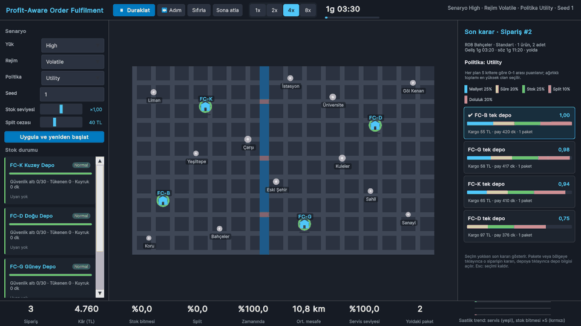
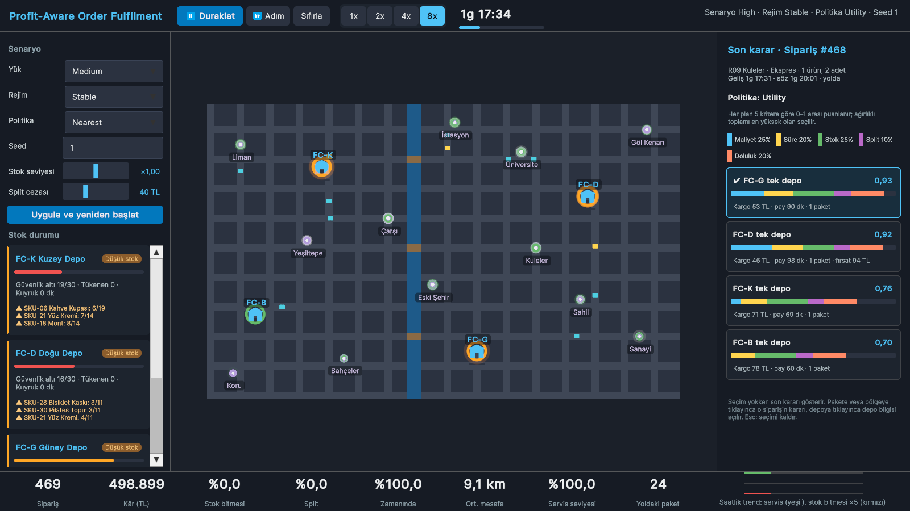
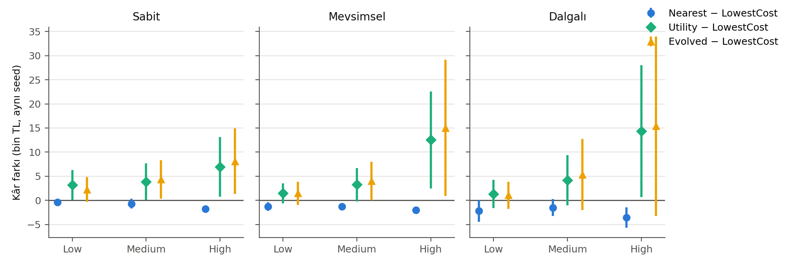
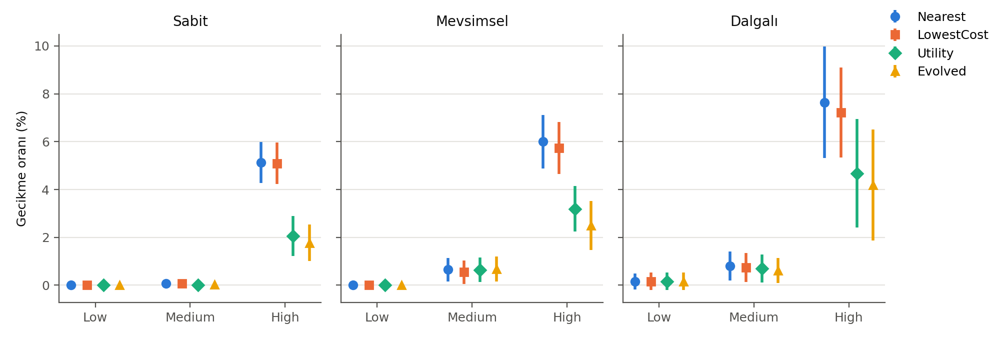
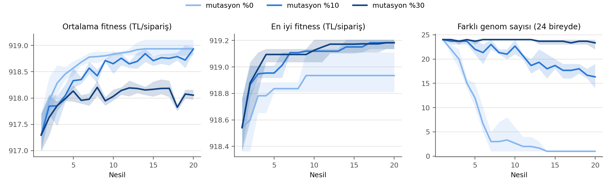

# Profit-Aware Order Fulfilment Agent (Unity 6.3)

BLM5026 Bilgisayar Oyunlarında Yapay Zeka · Dönem projesi (Proje 2) · Veysel Uğurlu
Bursa Teknik Üniversitesi, Bilgisayar Mühendisliği Yüksek Lisans · Doç. Dr. İzzet Fatih Şentürk

Aynı ürün birden fazla depoda bulunabiliyor. Her sipariş geldiğinde ajan, siparişi hangi depodan göndereceğine ya da bölüp bölmeyeceğine karar veriyor. Bunu yaparken kargo maliyetini, gecikmeyi, bölünmüş gönderiyi ve stok tükenmesini dengeliyor. Simülasyon gerçek zamanlı bir Unity sahnesinde çalışıyor; aynı kod deneylerde de kullanılıyor.

- **Baseline:** en yakın depo, en düşük kargo maliyeti
- **Zorunlu AI 1:** açıklanabilir Utility AI: her aday plan 5 kritere göre (maliyet, süre, stok sağlığı, split, doluluk) puanlanır, ağırlıklı toplamı en yüksek plan seçilir; her kararın puan dökümü arayüzde
- **Zorunlu AI 2:** zamanla karar ağırlıklarını uyarlayan öğrenen ajan (Contextual Bandit veya RL; vize sonrası)





*High yük, Utility AI, 8x hız. Solda senaryo paneli ve depoların stok kartları; ortada harita (halkalar stok durumu, çubuklar paketleme kuyruğu, turkuaz/sarı kareler standart/ekspres paketler); sağda son kararın açıklaması: her aday plan için kriter katkıları ve toplam puan. Bu örnekte Utility AI, daha ucuz olan Doğu deposu yerine Güney deposunu seçmiştir, çünkü Doğu deposundan gönderim ürünü güvenlik stoğunun altına indiriyordu.*

## Durum

| Sprint | Tarih | Konu | Durum |
|---|---|---|---|
| S1 | 25–27 Eki | Kurulum, domain modeli, sipariş üretici, veri profili | tamamlandı |
| S2 | 28–30 Eki | Simülasyon motoru, stok, maliyet modeli, baseline'lar | tamamlandı |
| S3 | 31 Eki–2 Kas | Harita, A* yol ağı, canlı görselleştirme | tamamlandı |
| S4 | 3–5 Kas | Utility AI ve arayüz panelleri | tamamlandı |
| S5 | 6–8 Kas | Deney altyapısı, ön sonuçlar, Paper Draft I | deneyler tamamlandı; makale ve sunum sürüyor |

Her sprint ayrı bir `feature/sNN-...` dalında geliştirilir ve Pull Request ile `main` dalına birleştirilir.

## Gereksinimler

- Unity 6000.3.x (6.3 LTS), Universal 2D, Input System
- Python 3.11 (veri hazırlama ve grafikler): `pip install -r tools/requirements.txt`

## Kurulum ve çalıştırma

1. Unity Hub → Add project from disk → bu klasör.
2. `Assets/_Game/Scenes/Main.unity` → **Play**.
3. Sahne kod ile kurulur: menü **Fulfilment → Build Main Scene**. Windows build: **Fulfilment → Build Windows Player** (çıktı `Builds/ProfitFulfilmentAgent/`).

```bash
Unity -batchmode -projectPath . -executeMethod Fulfilment.Editor.SceneBuilder.BuildSceneAndPlayerBatch -logFile build.log
```

### Kontroller

| Girdi | İşlev |
|---|---|
| Başlat / Duraklat, `Space` | simülasyonu başlatır veya duraklatır |
| Adım, `N` | bir simülasyon dakikası ilerletir |
| Sıfırla, `R` | episode'u aynı seed ile baştan kurar |
| 1x 2x 4x 8x, `1`–`4` | hız (1x'te bir saniye = 12 simülasyon dakikası) |
| Sol tık | depo, bölge veya paketi seçer; bilgileri sağ panelde |
| Sağ/orta tuşla sürükleme, `WASD` | haritayı kaydırır |
| Fare tekerleği, `F` | yakınlaştırır; `F` haritayı ekrana sığdırır |
| `Esc` | seçimi kaldırır |

### Paneller

- **Sol:** senaryo paneli (yük, rejim, politika, seed, stok seviyesi, split cezası; *Uygula* episode'u yeniden kurar, kod değişikliği gerekmez) ve her depo için stok kartı (stok sağlığı, tükenen ürünler, kuyruk, en kritik ürünler).
- **Sağ:** karar açıklaması. Seçim yokken son kararı, pakete veya bölgeye tıklanınca o siparişin kararını, depoya tıklanınca depo bilgisini gösterir.
- **Alt:** 8 canlı KPI ve saatlik servis seviyesi / stok bitmesi trendi.
- **Episode sonu özeti:** çalışan politikanın KPI'ları, diğer politikaların aynı seed ve aynı siparişlerle ekransız sonuçlarıyla yan yana; satır başına en iyi değer işaretli; "X ile oynat" aynı episode'u başka politikayla baştan oynatır. Üst çubuktaki *Sona atla* episode'u hemen bitirir.

### Komut satırı (build)

```bash
Builds/ProfitFulfilmentAgent/ProfitFulfilmentAgent.exe -scenario high -regime volatile -policy Utility -seed 3 -speed 4 -autoplay
```

Ek parametreler: `-select FC-D` (açılışta seç), `-skipToEndAt 10` (sona atla, özet ekranı), `-screenshot dosya.png -screenshotAt 15`, `-fpsLog fps.txt -quitAfter 30`, `-recordFrames klasör` (demo kareleri), `-batchmode -nographics -experiment ad` (ekransız deney).

### Performans

1600×900 ve 1280×720'de, High senaryo 8x hızda ortalama 60 FPS (dikey senkron sınırı), en kötü kare 17–38 ms (NVIDIA RTX 3050 Ti Laptop).

## Testler

EditMode testleri simülasyonun deterministik olduğunu (aynı seed → aynı sipariş akışı) ve ayarların föydeki minimumları karşıladığını kontrol eder.

```bash
Unity -batchmode -projectPath . -runTests -testPlatform EditMode -testResults results/tests.xml
```

Unity Editor'da: Window → General → Test Runner → EditMode → Run All.

## Ayarlar

Bütün parametreler `Assets/StreamingAssets/configs/` altında JSON dosyalarıdır; kod değiştirmeden ayarlanır.

| Dosya | İçerik |
|---|---|
| `world.json` | 64×40 kurgusal şehir, 4 depo, 12 müşteri bölgesi, 30 ürün |
| `demand_profile.json` | saatlik talep, sepet büyüklüğü, adet, ürün popülerliği (veri setinden) |
| `scenarios/low.json`, `medium.json`, `high.json` | yük seviyeleri: 3 günde yaklaşık 630 / 1020 / 1620 sipariş, teslim sözü, stok günü, yenileme |
| `cost.json` | kargo, split cezası, gecikme, kayıp satış ve fırsat maliyeti katsayıları; hız ve işlem süresi |
| `regimes/stable.json`, `seasonal.json`, `volatile.json` | talep rejimleri: sabit, mevsimsel dalga, rastgele talep şokları |
| `policies/utility_default.json` | Utility AI kriterleri, tepki eğrileri ve ağırlıkları |

## Veri seti

Talep deseni **UCI Online Retail II** veri setinden çıkarılır (Chen, 2012, [doi:10.24432/C5CG6D](https://doi.org/10.24432/C5CG6D), CC BY 4.0). Veriden yalnızca sipariş deseni alınır: saatlik dağılım, 1–5 ürünlük siparişlerin sepet büyüklüğü, satır başına adet ve en çok satan 30 ürünün sıralama-sıklık eğrisi. Depo ağı ve ürün kataloğu kurgusaldır. Ham veri repoya eklenmez; script onu indirilen zip dosyasından okur.

```bash
mkdir -p data/raw
curl -L -o data/raw/online_retail_ii.zip "https://archive.ics.uci.edu/static/public/502/online+retail+ii.zip"
python tools/prepare_retail_data.py data/raw/online_retail_ii.zip Assets/StreamingAssets/configs/demand_profile.json docs/data/retail_profile_stats.json
```

Temizleme adımları ve özet istatistikler `docs/data/retail_profile_stats.json` dosyasındadır.

## Hızlı kontrol

Unity menüsü **Fulfilment → Run Headless Check**: iki baseline × 3 yük × 3 rejim, tek seed. KPI tablosu Console'a, CSV'ler `results/_scratch/` altına yazılır.

```bash
Unity -batchmode -projectPath . -executeMethod Fulfilment.Editor.HeadlessRun.RunBatch -seed 1 -logFile log.txt
```

## Ön sonuçlar (Paper Draft I)

`vize_prelim` deneyi: Nearest, LowestCost, Utility ve Evolved × 3 yük × 3 rejim × 10 test seed (1001–1010), 360 episode. Her seed'de üç politika aynı sipariş akışıyla koşturulur; farklar aynı seed ve rejim üzerinden eşleşik olarak hesaplanır (n = 30). Ham veri `results/vize_prelim/runs.csv`, hangi kod ve ayarlarla üretildiği `meta.json` içindedir.

| Yük | Politika | Kâr (bin TL) | Servis (%) | Gecikme (%) | Split (%) | Stock-out (%) |
|---|---|---|---|---|---|---|
| Low | Nearest | 574,3 ± 48,2 | 85,9 ± 5,5 | 0,05 ± 0,27 | 7,27 ± 1,50 | 8,18 ± 4,40 |
| Low | LowestCost | 575,6 ± 48,0 | 85,9 ± 5,5 | 0,06 ± 0,29 | 6,07 ± 1,33 | 8,16 ± 4,38 |
| Low | Utility | 577,6 ± 48,7 | 86,2 ± 5,5 | 0,05 ± 0,29 | 5,54 ± 1,01 | 8,07 ± 4,40 |
| Low | Evolved | 577,2 ± 48,1 | 86,2 ± 5,5 | 0,05 ± 0,29 | 5,49 ± 1,28 | 8,07 ± 4,38 |
| Medium | Nearest | 943,3 ± 76,6 | 88,3 ± 5,9 | 0,51 ± 0,69 | 4,75 ± 1,47 | 6,82 ± 4,60 |
| Medium | LowestCost | 944,4 ± 76,7 | 88,4 ± 5,9 | 0,46 ± 0,67 | 3,69 ± 0,93 | 6,82 ± 4,61 |
| Medium | Utility | 948,2 ± 77,6 | 88,6 ± 5,9 | 0,45 ± 0,69 | 3,53 ± 0,91 | 6,69 ± 4,68 |
| Medium | Evolved | 949,0 ± 77,1 | 88,8 ± 5,8 | 0,44 ± 0,65 | 3,26 ± 0,98 | 6,62 ± 4,65 |
| High | Nearest | 1.507,2 ± 123,1 | 84,3 ± 5,9 | 6,26 ± 2,37 | 3,46 ± 1,22 | 6,73 ± 4,98 |
| High | LowestCost | 1.509,7 ± 122,7 | 84,4 ± 5,8 | 6,02 ± 2,03 | 2,52 ± 1,01 | 6,72 ± 4,97 |
| High | Utility | 1.521,0 ± 122,9 | 87,1 ± 6,2 | 3,31 ± 2,30 | 2,23 ± 0,84 | 6,46 ± 5,00 |
| High | Evolved | 1.522,5 ± 122,5 | 87,6 ± 6,2 | 2,82 ± 2,31 | 1,88 ± 0,75 | 6,40 ± 5,02 |

*Ortalama ± standart sapma, hücre başına 30 episode (10 seed × 3 rejim). Seed'ler arası fark büyük olduğu için politikalar eşleşik farklarla karşılaştırılır:* Utility − LowestCost kâr farkı Low'da +2.010 TL (%95 GA [+588, +3.432], p = 0,007), Medium'da +3.782 TL ([+1.649, +5.916], p = 0,001), High'da +11.263 TL ([+5.875, +16.652], p = 0,0002). High yükte Utility gecikme oranını 2,7 puan (yaklaşık %45) düşürür ve servis seviyesini 2,7 puan artırır (p < 0,0001, 30 eşleşmenin 30'unda). GA ile evrimleşen karar tablosu (Evolved), sabit ağırlıklı Utility'ye göre kârda anlamlı fark göstermez; High yükte gecikmeyi 0,49 puan daha düşürür (%3,31 → %2,82, p < 0,001, 30 eşleşmenin 28'inde) ve servis seviyesini 0,47 puan artırır (p < 0,001).




## Genetik algoritma ile evrimleşen karar tablosu (Hafta 7)

Dersin "Stay on Platform" uygulamasındaki `DNA` / `Brain` / `PopulationManager` yapısı sipariş ajanına uyarlanmıştır. Botun "önümde zemin var mı?" sensörünün yerini üç ikili sensör alır (sipariş ekspres mi, en yakın depoda stok riski var mı, en yakın deponun kuyruğu 30 dakikayı geçti mi). 8 durumun her biri için bir gen, siparişin hangi Utility ağırlık profiliyle (dengeli, maliyet öncelikli, hız öncelikli, stok koruyucu) karar verileceğini seçer. Operatörler dersteki gibidir: tek noktalı çaprazlama, gen başına farklı değere mutasyon, en iyi 2 bireyin korunması, üst yarıdan ebeveyn seçimi, 24 bireylik sabit nüfus. Fitness, 4 eğitim episode'unda sipariş başına kârdır.

Dersin sınıf deneyi tekrarlanmıştır: %0 / %10 / %30 mutasyon × 3 GA seed (2026–2028), 20 nesil. %0 mutasyonda çeşitlilik 5–7 nesilde tek genoma çöker ve en iyi fitness daha düşükte kalır; %10 en iyi sonuca ulaşır; %30 çeşitliliği korur ama ortalama fitness'i düşürür. Doğrulama seed'lerinde (501–510) en iyi çıkan genom `[0, 0, 0, 3, 2, 0, 3, 2]`'dir: ekspres siparişte hız öncelikli, stok riskinde stok koruyucu profil.



```bash
Unity -batchmode -projectPath . -executeMethod Fulfilment.Editor.ExperimentCli.Evolve -experiment evolve_profiles -logFile evolve.log
python tools/analyze_evolution.py results/evolve_profiles
```

Föye göre genetik algoritma tek başına zorunlu Game AI çekirdeği sayılmaz; burada karşılaştırma yöntemi olarak raporlanır. Zorunlu öğrenen ajan (Contextual Bandit veya pekiştirmeli öğrenme) sonraki aşamadadır.

## Deneyleri tekrar üretme

Deneyler `Assets/StreamingAssets/configs/experiments/*.json` dosyalarıyla tanımlanır. Seed setleri kodda tek yerde tanımlıdır (`SeedSets`): eğitim 1–40, doğrulama 501–510, test 1001–1010. Raporlanan sonuçlar yalnızca test seed'lerinden gelir; ayarlama ve kalibrasyon eğitim seed'leriyle yapılır.

```bash
# 1) Deneyi koştur (Unity Editor, ekransız) -> results/vize_prelim/runs.csv + meta.json
Unity -batchmode -projectPath . -executeMethod Fulfilment.Editor.ExperimentCli.Run -experiment vize_prelim -logFile exp.log
# veya build ile (aynı sonuç)
Builds/ProfitFulfilmentAgent/ProfitFulfilmentAgent.exe -batchmode -nographics -experiment vize_prelim -out results/vize_prelim

# 2) Tablolar, eşleşik karşılaştırmalar ve figürler
python tools/analyze.py results/vize_prelim
```

`analyze.py` çıktıları: `summary.csv` (politika × yük × rejim için ortalama, std, %95 GA), `comparisons.csv` (Utility'nin her politikaya karşı eşleşik farkı, t-testi, Wilcoxon, Cohen's d; `better_policy` ve `significant_95` sütunları farkın yönünü ve anlamlılığını açıkça yazar), `table_main.csv/.tex`, `figures/*.png|pdf`. Editör ve build aynı deneyde birebir aynı `runs.csv`'yi üretir (çalışma süresi sütunu hariç).

## Proje yapısı

```
Assets/_Game/Scripts/Simulation/    saf C#: dünya, stok, sipariş üretici, rastgele sayı akışları (UnityEngine yok)
Assets/_Game/Scripts/AI/            saf C#: politikalar (baseline, Utility AI, öğrenen ajan)
Assets/_Game/Scripts/Experiments/   saf C#: deney koşucu
Assets/_Game/Scripts/Presentation/  Unity: sahne, arayüz, ayar yükleyici
Assets/_Game/Tests/EditMode/        birim testleri
Assets/StreamingAssets/configs/     JSON ayarlar
tools/                              veri hazırlama ve analiz scriptleri (Python)
docs/                               veri istatistikleri, görseller
```

AI, simülasyon ve arayüz katmanları ayrı assembly'lerdir. Simülasyon ve AI katmanı UnityEngine'e bağlı değildir; böylece canlı demo ile deney koşusu aynı kodu kullanır.

## Game AI Connection

S10'da tamamlanacak. Bu bölümde Utility AI'ın oyunlardaki rolü (NPC'lerin ihtiyaçlarına göre eylem seçmesi) ile bu projedeki rolü (siparişin karşılanma planını seçmek) karşılaştırılacak. Öğrenen ajanın oyunlardaki uyarlanabilir yapay zekâ ile bağlantısı da burada anlatılacak.

## Lisanslar

| Kaynak | Lisans |
|---|---|
| UCI Online Retail II veri seti | CC BY 4.0 |
| Kod | ders projesi, tüm hakları saklıdır |
| İkonlar ve harita zemini | harici asset yok; `SpriteFactory` ile kod içinde çizilir |

## Yapay zekâ kullanımı

Ders politikası gereği belirtilir: çalışmanın hazırlanmasında yapay zekâ destekli araçlardan yararlanılmıştır.
